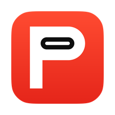
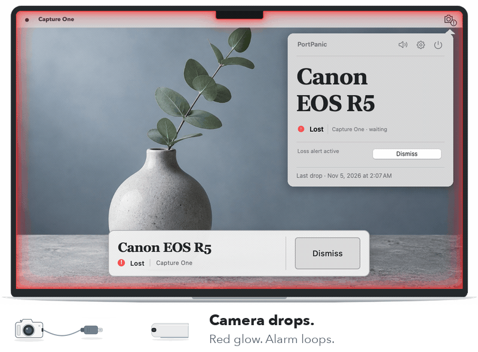
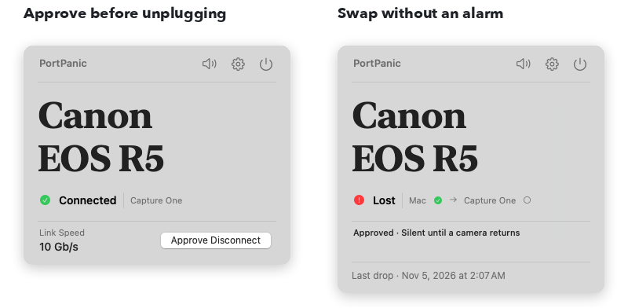

  

<h1 align="center">Know when your tether drops.</h1>

  <b>PortPanic</b> is a free macOS menu bar app for Capture One.

  <a href="https://austinpresley.github.io/PortPanic-Releases/#download"><b>Download 3.2.0 Beta 2</b></a>
  &emsp;
  <a href="https://austinpresley.github.io/PortPanic-Releases/#try-it">Try&nbsp;it&nbsp;with&nbsp;sound</a>

macOS 14 or later · Apple silicon and Intel · Capture One 16.x

  <picture>
    <source media="(prefers-reduced-motion: reduce) and (prefers-color-scheme: dark) and (max-width: 600px)" srcset=".github/readme/demo-still-dark-mobile.png">
    <source media="(prefers-reduced-motion: reduce) and (max-width: 600px)" srcset=".github/readme/demo-still-light-mobile.png">
    <source media="(prefers-reduced-motion: reduce) and (prefers-color-scheme: dark)" srcset=".github/readme/demo-still-dark.png">
    <source media="(prefers-reduced-motion: reduce)" srcset=".github/readme/demo-still-light.png">
    <source media="(prefers-color-scheme: dark) and (max-width: 600px)" srcset=".github/readme/demo-dark-mobile.gif">
    <source media="(max-width: 600px)" srcset=".github/readme/demo-light-mobile.gif">
    <source media="(prefers-color-scheme: dark)" srcset=".github/readme/demo-dark.gif">
    
  </picture>

Every display glows red and the alarm loops until the camera returns or you dismiss it. Your keyboard stays in Capture One.

**One missed reading never triggers an alarm.** Capture One confirms the tether. Quitting Capture One or closing the session or catalog leaves PortPanic quiet.

## Unplug on purpose

Swapping a battery? Choose **Approve Disconnect** in the menu, press <kbd>⌃</kbd><kbd>⌥</kbd><kbd>⌘</kbd><kbd>D</kbd> or tap the optional Stream Deck key. Unplug within 15 seconds. That drop stays silent, and the green Recovery alert still confirms the return.

  <picture>
    <source media="(prefers-color-scheme: dark) and (max-width: 600px)" srcset=".github/readme/swap-dark-mobile.png">
    <source media="(max-width: 600px)" srcset=".github/readme/swap-light-mobile.png">
    <source media="(prefers-color-scheme: dark)" srcset=".github/readme/swap-dark.png">
    
  </picture>
   Menu layout included in Beta 2.

- **Catch slow USB links.** Get a warning below 5 Gb/s or below the fastest speed seen during the current watch.
- **Keep it local.** No account or analytics. Camera history and logs stay on your Mac.

## Before your first shoot

1. [Download the DMG](https://austinpresley.github.io/PortPanic-Releases/#download) and drag PortPanic to Applications.
2. Open Capture One with a session or catalog. Open PortPanic and allow Capture One access when asked.
3. Tether your camera. In Settings, Alerts, choose **Test Loss Alert** to check the glow and sound. Take a test photo in Capture One to verify capture.

> [!NOTE]
> This is a public beta. Real-camera, extended-shooting, fresh-install and macOS 14/Intel checks are still in progress. Test with your setup before relying on it during a shoot.

How PortPanic watches your camera

PortPanic reads Capture One's tethered-camera list every second or two. Access is read-only. It never changes your session or catalog. A drop needs a matching USB removal or two consecutive Capture One checks. USB alone never counts as connected.

The hero animates the website demo with native menu captures from build 467. The same menu layout is included in the current Beta 2 download, build 469. The illustrated demo shows the alert and approved-disconnect behavior.

  <a href="https://austinpresley.github.io/PortPanic-Releases/guide.html">User guide</a> ·
  <a href="https://github.com/austinpresley/PortPanic-Releases/issues/new?template=bug_report.yml">Report a problem</a> ·
  <a href="https://github.com/austinpresley/PortPanic-Releases/releases">Release notes</a> ·
  <a href="https://buymeacoffee.com/apresley">Buy me a coffee</a>

This repository holds downloads, release notes, the update feed and the website. Free to use and share unmodified. Application source is private. Bundled components keep their own licenses in the app's ThirdPartyNotices.txt.

