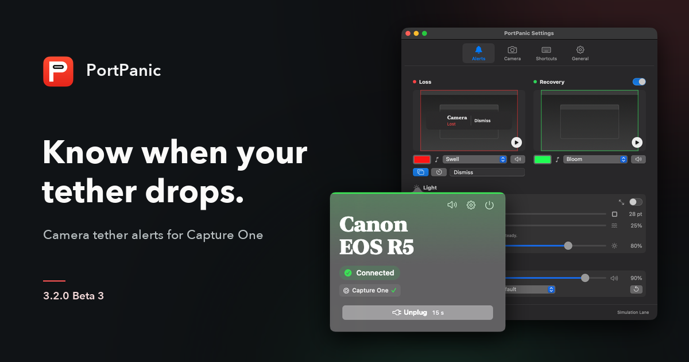

  

# PortPanic

A free macOS menu bar app that warns you when your Capture One tether drops.

**[Download 3.2.0 Beta 3](https://austinpresley.github.io/PortPanic-Releases/#download)** · [Try the alert with sound](https://austinpresley.github.io/PortPanic-Releases/#try-it)

macOS 14 or later · Apple silicon and Intel · Capture One 16.x

- **Tether drops.** Red glow and a repeating alarm. Dismiss it or reconnect.
- **Tether returns.** A short green glow and sound.
- **Swapping a battery?** Choose **Unplug** first for a quiet disconnect. An [optional Stream Deck key](https://austinpresley.github.io/PortPanic-Releases/guide.html#stream-deck) does the same thing.

Open the DMG, drag PortPanic to Applications, and allow Capture One access when asked. Before a shoot, test the Loss alert and take a test photo.

> [!NOTE]
> Real-camera, extended-shooting, fresh-install and macOS 14/Intel checks are in progress. Test your setup before a shoot.

[User guide](https://austinpresley.github.io/PortPanic-Releases/guide.html) · [Release notes](https://github.com/austinpresley/PortPanic-Releases/releases) · [Report a problem](https://github.com/austinpresley/PortPanic-Releases/issues/new?template=bug_report.yml) · [Buy me a coffee](https://buymeacoffee.com/apresley)

Monitoring stays on your Mac. Free to use and share unmodified. Application source is private.
